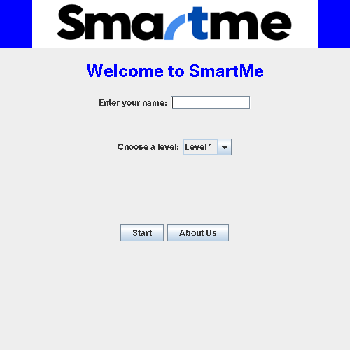
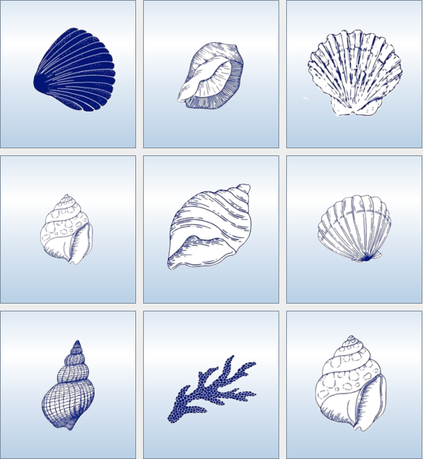
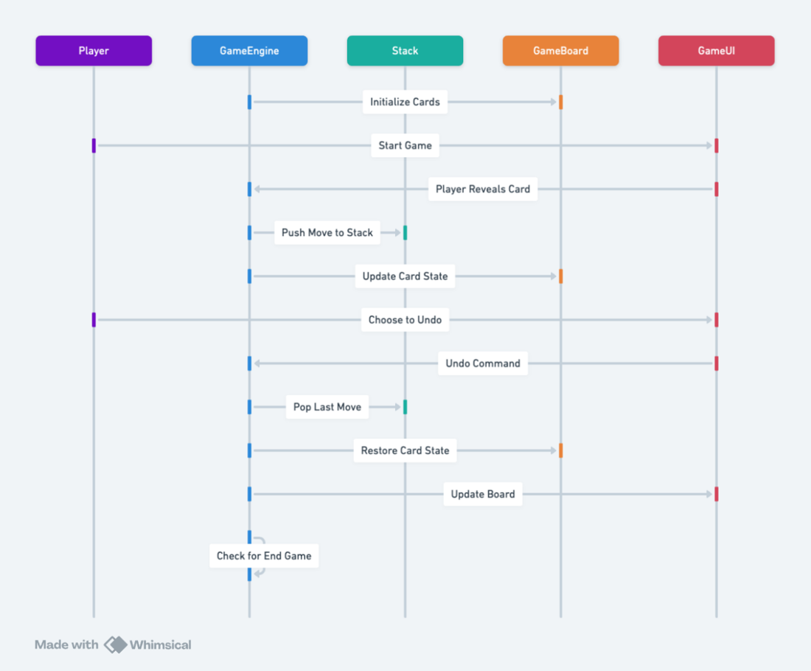
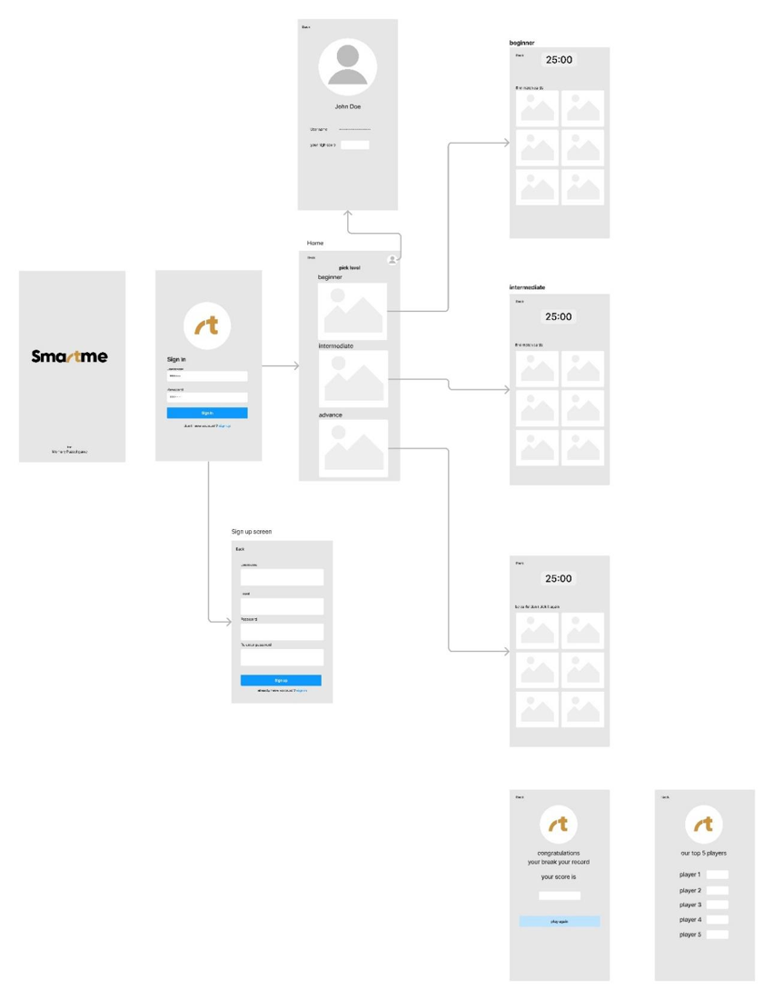

# 🧠 SmartMe: A Memory Puzzle Game

<p align="center">
  
</p>

**SmartMe** is a Java desktop app that trains your memory through two mini-games. Enter your name, pick a level, and see how good your memory really is.

> Team project · Java Swing · Imam Abdulrahman Bin Faisal University (IAU)

---

<p align="center">
  
  
  
</p>

## 🎮 Levels

### Level 1: Flip-Match Card Game 🃏
Flip two cards at a time and find the matching pairs.
- A match keeps the pair face up and earns **10 points**.
- No match, and the cards flip back face down.
- Match every pair within the **80-second** time limit to win.

### Level 2: Sea Shell Memory Game 🐚
Nine shells are shuffled on the board every turn.
- Pick a different shell each round, and never choose the same one twice.
- Finish all rounds without repeating a choice and you win. Repeat a shell and it's game over!

## ✨ Features

- Home page with player name entry and a **welcome back** message for returning players
- Level selection with a short description of each game
- Timer, scoring and win/lose messages
- **About Us** page
- Built with core data structures: a **stack** tracks the selected shells and a linked list stores player names

## 🧩 Design

The game was designed around the **stack** data structure (array-based and linked-list stacks) as part of a Data Structures course.

<p align="center">
  <br>
  <sub>Sequence diagram: player, game engine, stack and scoreboard</sub>
</p>
<p align="center">
  <br>
  <sub>UI wireframes</sub>
</p>

The full proposal is in [`docs/smartme-project-proposal.pdf`](docs/smartme-project-proposal.pdf). It covers the idea, how each stack operation is used (level setup, card matching, leaderboard), the architecture, UI and planned database schema.

## 📁 Project structure

```
.
├── src/seashellfinaalgame/
│   ├── HomePage.java            # Main window: name entry, level selection, About Us
│   ├── FlipMatchCardGame.java   # Level 1: card matching game
│   ├── ShellGame.java           # Level 2: sea shell memory game
│   └── images/                  # Shell images (loaded from the classpath)
├── assets/                      # Card images, logo and icons
├── docs/                        # Project proposal + design diagrams
├── nbproject/  build.xml  manifest.mf   # NetBeans project files
└── README.md
```

## ▶️ How to run

**NetBeans:** open the folder as a project and press **Run** (the main class is `HomePage`).

**Command line** (Java 8+), from the project root:

```bash
javac -d out src/seashellfinaalgame/*.java
cp -r src/seashellfinaalgame/images out/seashellfinaalgame/
java -cp out seashellfinaalgame.HomePage
```

Run it from the project root so the game can find the `assets/` folder.

---

<details>
<summary>🇸🇦 ملخص بالعربي</summary>

**SmartMe** تطبيق Java لتمرين الذاكرة، فيه مستويين: لعبة قلب البطاقات ومطابقتها، ولعبة الأصداف (تختار صدفة مختلفة كل جولة بدون ما تكرر). مشروع مادة هياكل البيانات، ومبني على فكرة الـ **Stack**.
</details>
